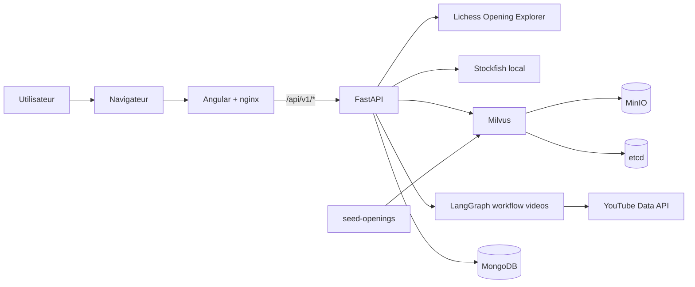

# Note systeme - Agent IA ouvertures d'echecs

## Objectif

Le projet fournit un POC local d'agent IA pour l'entrainement aux ouvertures
d'echecs. L'utilisateur joue une position sur un echiquier Angular, puis le
backend FastAPI orchestre plusieurs services pour proposer coups theoriques,
evaluation moteur, contexte pedagogique et videos.

Le systeme repond aux livrables techniques avec :

- LangGraph pour le workflow de recherche video.
- FastAPI pour l'API applicative.
- Milvus pour la recherche vectorielle sur le corpus d'ouvertures.
- MongoDB pour l'historisation des interactions agent.
- Docker Compose pour une demonstration locale reproductible.

## Architecture technique

### Role des composants

- **Angular/nginx** : interface utilisateur et proxy `/api/v1` vers FastAPI.
- **FastAPI** : expose les endpoints d'analyse, de recherche et d'historique.
- **LangGraph** : encapsule le workflow de recherche video.
- **Milvus** : indexe le corpus d'ouvertures et retourne les notes proches de la recherche.
- **MongoDB** : stocke les evenements agent (`moves`, `evaluate`, `vector_search`, `videos`).
- **Stockfish** : evalue localement la position FEN.
- **Lichess** : fournit les coups theoriques d'ouverture.
- **YouTube Data API** : fournit les videos pedagogiques associees a une ouverture.

## Benefices

- **Execution locale simple** : `docker compose up --build` demarre l'ensemble du POC.
- **Separation claire des responsabilites** : UI, API, vecteurs, historique et workflows sont decouples.
- **Recherche pedagogique enrichie** : Milvus retrouve rapidement les notes d'ouverture pertinentes.
- **Tracabilite** : MongoDB conserve les actions recentes pour audit, demo et diagnostic.
- **Extensibilite agent** : LangGraph peut accueillir plus d'etapes, par exemple classement, synthese ou personnalisation.
- **Cout POC faible** : la majorite des composants sont auto-heberges localement et open source.

## Limites

- **Dependances externes** : Lichess et YouTube peuvent imposer auth, quotas ou indisponibilite.
- **Corpus limite** : le corpus Milvus embarque est volontairement petit pour la demo.
- **Embeddings simples** : l'indexation utilise des embeddings lexicaux haches, suffisants pour le POC mais moins riches qu'un modele semantique.
- **Pas d'auth utilisateur** : l'historique MongoDB est global, pas rattache a un compte.
- **Non dimensionne production** : Docker Compose convient a la demo locale, pas a une haute disponibilite.
- **Observabilite minimale** : logs applicatifs et historique existent, mais pas encore de traces distribuees ni dashboards.

## Faisabilite et couts

### POC local

Le POC local est faisable sans cout cloud direct :

- Docker Desktop ou Docker Engine local.
- MongoDB, Milvus, MinIO, etcd et FastAPI dans Docker.
- Stockfish installe dans l'image backend.
- Lichess et YouTube consommes via API.

Points d'attention :

- YouTube Data API fournit un quota par defaut de 10 000 unites par jour; `search.list` consomme 100 unites, soit environ 100 recherches par jour avec le quota standard.
- MongoDB local n'ajoute pas de cout, mais demande un volume persistant.
- Milvus local consomme davantage de RAM que MongoDB; prevoir une machine de demo confortable.

### Petite production pilote

Une production pilote reste faisable avec une architecture simple :

- Frontend et API sur une petite VM ou service conteneur.
- MongoDB Atlas pour l'historique.
- Zilliz Cloud ou Milvus manage pour les vecteurs.
- Secrets geres via variables d'environnement ou coffre a secrets.

Estimation indicative mensuelle :

| Poste | Option POC | Option pilote |
| --- | ---: | ---: |
| MongoDB | Local Docker: 0 USD | Atlas Free: 0 USD, puis M10 dedie autour de 60 USD/mois selon region |
| Milvus | Local Docker: 0 USD | Zilliz Cloud Free: 0 USD pour prototype, puis offre Standard selon volume |
| API + frontend | Local Docker: 0 USD | Petite VM Linux: environ 30-70 USD/mois selon fournisseur et taille |
| YouTube Data API | Quota standard inclus | Quota standard inclus, demande d'audit si besoin de quota superieur |
| Lichess + Stockfish | Inclus | Inclus, hors cout d'hebergement de l'API |

Ces montants sont suffisants pour un pilote faible trafic. Pour une production
avec utilisateurs reels, il faut ajouter sauvegardes, monitoring, alerting,
authentification, chiffrement des secrets, et tests de charge.

### Sources de prix et quotas

- MongoDB Atlas Pricing : https://www.mongodb.com/pricing
- MongoDB Atlas AWS pricing : https://www.mongodb.com/products/platform/atlas-cloud-providers/aws/pricing
- YouTube Data API quota calculator : https://developers.google.com/youtube/v3/determine_quota_cost
- YouTube quota and compliance audits : https://developers.google.com/youtube/v3/guides/quota_and_compliance_audits
- Zilliz Cloud pricing : https://zilliz.com/pricing
- AWS EC2 On-Demand pricing : https://aws.amazon.com/ec2/pricing/on-demand/

## Recommandation

Pour le rendu client, conserver Docker Compose comme support de demonstration et
presenter MongoDB via l'endpoint `/api/v1/history?limit=20`. Pour une suite
projet, prioriser :

1. Remplacer les embeddings haches par un modele semantique.
2. Ajouter une authentification utilisateur.
3. Isoler les historiques par utilisateur.
4. Ajouter monitoring et alerting.
5. Deployer Milvus/MongoDB en services manages si le trafic devient regulier.
