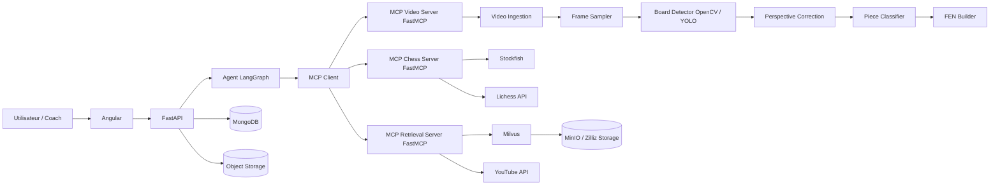

# Note de conception - Systeme avance d'analyse video

## 1. Objectif

Cette note decrit une extension possible du projet: analyser une video ou un
flux camera d'une partie d'echecs afin d'extraire automatiquement les positions
FEN, detecter les coups joues, puis connecter ces positions a l'agent existant
pour produire des conseils pedagogiques.

Le livrable attendu ici est volontairement une conception, pas une
implementation. Le but est de verifier la faisabilite technique, les benefices,
les limites, les couts et une architecture modulaire utilisant MCP.

Le systeme cible doit permettre:

- ingestion d'une video ou d'un flux live;
- detection de l'echiquier dans l'image;
- correction de perspective;
- classification des pieces par case;
- reconstruction FEN;
- validation par moteur d'echecs et historique de coups;
- appel de l'agent existant pour evaluation Stockfish, contexte Milvus, Lichess
  et videos YouTube;
- stockage des resultats et traces pour audit.

## 2. Contexte fonctionnel

Le POC actuel travaille a partir d'une FEN fournie par l'interface Angular. Le
systeme video ajouterait une couche amont: transformer une image reelle de
l'echiquier en FEN fiable.

La difficulte principale n'est pas l'appel a Stockfish ou a Lichess: ces briques
existent deja. Le coeur du risque est la vision par ordinateur:

- camera pas parfaitement au-dessus de l'echiquier;
- occlusion par les mains;
- reflets, ombres, faible luminosite;
- pieces de styles differents;
- echiquiers physiques sans coordonnees visibles;
- deplacement temporaire d'une piece entre deux cases;
- erreurs de classification qui produisent une FEN illegale.

Un systeme robuste doit donc combiner vision, validation chess, et logique de
confiance plutot qu'un simple modele image -> FEN.

## 3. Architecture technique cible avec MCP

### Role des composants

- **Angular**: interface de depot video, lecture du flux, affichage timeline,
  FEN detectees, coups et recommandations.
- **FastAPI**: API principale du produit, authentification future,
  orchestration des jobs et exposition des resultats.
- **LangGraph**: agent applicatif qui decide quand appeler la vision, le moteur,
  la recherche documentaire et les sources externes.
- **MCP Client**: couche standard permettant a l'agent d'appeler des outils
  externes exposes par des serveurs MCP.
- **FastMCP Video Server**: expose les outils `sample_frames`,
  `detect_board`, `classify_position`, `build_fen`.
- **FastMCP Chess Server**: expose `evaluate_fen`, `validate_move`,
  `query_opening_book`.
- **FastMCP Retrieval Server**: expose `search_opening_context` et
  `search_training_videos`.
- **MongoDB**: historique des analyses, erreurs, scores de confiance,
  decisions agent.
- **Object Storage**: stockage des videos sources, frames extraites, images
  annotees et exports de debug.
- **Milvus**: recherche vectorielle pour contexte pedagogique et, a terme,
  recherche de positions ou patterns similaires.

MCP est utile ici car il evite de lier l'agent a une implementation unique. Le
serveur vision peut etre remplace ou deplace sur une machine GPU sans changer le
contrat logique de l'agent.

## 4. Pipeline video propose

### 4.1 Ingestion

Le systeme accepte deux modes:

- **Batch**: upload d'une video courte, analyse asynchrone, restitution apres
  traitement.
- **Live assiste**: flux camera, analyse toutes les N secondes, correction
  manuelle possible.

Pour un premier pilote, le batch est plus realiste. Il simplifie les timeouts,
permet de rejouer les frames et evite d'exiger une faible latence.

### 4.2 Echantillonnage des frames

Le systeme ne doit pas analyser toutes les images. Pour une video 30 FPS de 10
minutes, cela ferait 18 000 frames. Un echantillonnage toutes les 0,5 a 1,0
secondes suffit souvent pour detecter une position stable.

Une heuristique simple:

- ignorer les frames floues;
- ignorer les frames ou une main est detectee;
- garder les frames stables plusieurs centaines de millisecondes;
- detecter les changements significatifs de position.

### 4.3 Detection de l'echiquier

Deux familles de methodes sont possibles.

**OpenCV geometrique**

- detection de contours;
- lignes de Hough;
- detection de coins;
- homographie pour remettre l'echiquier a plat.

Avantages: rapide, explicable, peu couteux, fonctionne bien avec camera fixe et
bon contraste.

Limites: fragile sur reflets, angles extremes, echiquier partiellement cache,
fonds visuellement charges.

**Modele de vision**

- detection object detection type YOLO/RT-DETR pour localiser l'echiquier;
- segmentation possible pour isoler le plateau;
- classification par case avec CNN ou ViT leger.

Avantages: plus robuste aux conditions reelles si le dataset est bon.

Limites: besoin de donnees annotees, entrainement, monitoring de derive, cout
GPU potentiel.

Le projet open source `fenify-3D` montre une piste interessante: transformation
d'images reelles d'echiquier en FEN, avec un dataset combinant images
synthetiques et collecte terrain. Il souligne aussi un point cle: les angles de
camera non top-down rendent le probleme plus difficile mais plus utile en
conditions reelles.

### 4.4 Correction de perspective

Une fois les quatre coins detectes, une homographie transforme l'image en grille
8x8 normalisee. Chaque case peut alors etre croppee puis envoyee a un
classifieur.

Cette etape doit conserver:

- image source;
- image corrigee;
- coordonnees des coins;
- score de confiance.

Ces artefacts sont indispensables pour debug et demonstration client.

### 4.5 Classification des pieces

Le classifieur doit predire 13 classes:

- case vide;
- roi, dame, tour, fou, cavalier, pion blancs;
- roi, dame, tour, fou, cavalier, pion noirs.

Pour un POC, on peut commencer avec:

- un modele pre-entraine de vision fine-tune;
- augmentation de donnees: luminosite, rotation, flou, ombre;
- jeu de donnees synthetique puis validation avec vraies photos.

Le systeme doit retourner une probabilite par case. Une FEN n'est acceptee que
si le score global depasse un seuil configurable.

### 4.6 Reconstruction FEN et validation chess

La FEN brute doit etre validee par des regles d'echecs:

- exactement un roi blanc et un roi noir;
- nombre de pieces plausible;
- pas de pions sur premiere ou huitieme range;
- position legalement atteignable si un historique existe;
- coup detecte coherent avec la position precedente.

Stockfish et `python-chess` peuvent aider a filtrer les impossibilites, mais ils
ne corrigent pas seuls une mauvaise detection. En cas de doute, l'UI doit
proposer une correction manuelle.

## 5. Benefices attendus

### 5.1 Valeur utilisateur

Le systeme permettrait a un joueur ou un coach d'obtenir une analyse sans saisir
manuellement la position. Pour les clubs, cours en ligne ou videos pedagogiques,
cela reduit la friction et accelere le passage de l'observation a l'explication.

### 5.2 Valeur produit

L'analyse video transforme le POC actuel en assistant plus complet:

- extraction automatique de positions;
- analyse multi-position sur une partie entiere;
- historique de progression;
- generation de moments cles;
- recommandations contextualisees.

### 5.3 Valeur technique

L'architecture MCP separe les outils. Le module vision peut evoluer
independamment du backend. Les serveurs MCP peuvent etre locaux pour une demo,
puis deployes separement en production.

## 6. Limites et risques

### 6.1 Risques techniques

- **Precision insuffisante**: une seule piece mal reconnue peut invalider toute
  la FEN.
- **Generalisation difficile**: les pieces et echiquiers physiques varient
  enormement.
- **Occlusions**: mains, pendule, captures et mouvements rapides perturbent
  l'analyse.
- **Latence**: le live demande une pipeline optimisee, probablement GPU.
- **Dataset**: sans donnees annotees representant les conditions reelles, le
  modele sera fragile.
- **Explicabilite**: il faut afficher les frames annotees et scores de confiance
  pour que l'utilisateur fasse confiance au systeme.

### 6.2 Risques business

- **Cout superieur a la valeur percue** si la precision n'est pas forte.
- **Support utilisateur eleve** en cas de cameras mal placees.
- **Concurrence** avec outils specialises d'analyse video chess.
- **Droits et vie privee** si les videos contiennent des personnes.
- **Dependance cloud** si l'inference GPU est necessaire.

## 7. Faisabilite

### MVP recommande

Un MVP realiste sur 4 a 6 semaines:

1. Upload d'image fixe ou frame extraite.
2. Detection echiquier en conditions controlees.
3. Correction perspective.
4. Classification simple des pieces.
5. FEN avec score de confiance.
6. Correction manuelle dans l'UI.
7. Appel de l'agent `/api/v1/coach` avec la FEN validee.

Le live video doit venir apres. Il augmente fortement la complexite sans etre
necessaire pour prouver la valeur.

### Conditions de reussite

- camera stable;
- echiquier visible en entier;
- dataset representatif;
- seuil de confiance clair;
- fallback manuel;
- tests sur plusieurs sets de pieces;
- mesure de precision case par case et FEN complete.

## 8. Estimation des couts de build

Hypotheses:

- equipe reduite;
- POC image fixe puis video batch;
- pas de live temps reel au depart;
- reutilisation du backend actuel.

| Lot | Charge estimee | Cout indicatif |
| --- | ---: | ---: |
| Cadrage et specification | 2-3 jours | 1 000-2 500 EUR |
| Prototype OpenCV detection plateau | 4-6 jours | 2 000-5 000 EUR |
| Dataset initial et annotation | 5-10 jours | 3 000-10 000 EUR |
| Modele classification pieces | 6-10 jours | 4 000-12 000 EUR |
| Integration MCP/FastAPI/LangGraph | 4-6 jours | 2 500-7 000 EUR |
| UI Angular upload/correction | 4-7 jours | 2 500-7 000 EUR |
| Tests, metriques, doc demo | 3-5 jours | 1 500-5 000 EUR |
| **Total MVP** | **28-47 jours** | **16 500-48 500 EUR** |

Ces montants sont des ordres de grandeur. Ils varient fortement selon le niveau
de qualite attendu et la disponibilite d'un dataset exploitable.

## 9. Estimation des couts OPEX

### Scenario POC local

| Poste | Hypothese | Cout mensuel |
| --- | --- | ---: |
| Backend/API | Docker local | 0 EUR cloud |
| MongoDB | Docker local | 0 EUR cloud |
| Milvus | Docker local | 0 EUR cloud |
| Stockage video | disque local | 0 EUR cloud |
| Inference vision | CPU local | 0 EUR cloud |
| APIs externes | quotas gratuits Lichess/YouTube | 0 EUR hors depassement |

Ce scenario convient pour soutenance et demo controlee.

### Scenario pilote cloud faible trafic

Hypothese: 100 videos par mois, 10 minutes chacune, analyse batch, conservation
des videos 30 jours.

| Poste | Option | Cout mensuel indicatif |
| --- | --- | ---: |
| API + frontend | petite VM ou service conteneur | 30-80 EUR |
| MongoDB Atlas | M0/M10 selon besoin | 0-70 EUR |
| Milvus/Zilliz | free/serverless ou petit dedie | 0-200 EUR |
| Stockage objet | 100-300 Go | 3-15 EUR hors egress |
| GPU ponctuel | instance type g5.xlarge quelques heures | 20-150 EUR |
| Monitoring/logs | basique | 0-50 EUR |
| **Total pilote** | | **50-565 EUR/mois** |

### Scenario production moderee

Hypothese: plusieurs milliers de videos par mois, files de jobs, inference GPU
plus frequente, stockage durable.

| Poste | Cout mensuel indicatif |
| --- | ---: |
| API et workers | 150-600 EUR |
| GPU inference batch | 500-3 000 EUR |
| Stockage objet + egress | 50-500 EUR |
| MongoDB dedie | 70-300 EUR |
| Vector DB managee | 200-800 EUR |
| Observabilite, sauvegardes | 100-400 EUR |
| **Total production moderee** | **1 070-5 600 EUR/mois** |

## 10. Alternatives

### Alternative A - POC OpenCV prioritaire

On commence avec OpenCV et camera controlee. C'est l'option la moins couteuse et
la plus rapide.

Avantages:

- pas ou peu de GPU;
- explicable;
- simple a debugger;
- bon choix pour demo.

Limites:

- faible robustesse hors conditions controlees;
- correction manuelle plus frequente.

### Alternative B - Modele vision entraine

On construit un dataset synthetique + reel, puis on fine-tune un modele de
detection/classification.

Avantages:

- meilleure robustesse potentielle;
- adaptable a plus de cameras et de pieces;
- trajectoire production plus credible.

Limites:

- cout de donnees;
- cout GPU;
- besoin de MLOps et monitoring.

### Alternative C - Semi-automatique

Le systeme detecte le plateau et propose une FEN, mais l'utilisateur valide ou
corrige avant analyse.

Avantages:

- tres bon compromis POC;
- reduit le risque de mauvaise recommandation;
- experience utilisateur acceptable pour coachs.

Limites:

- moins magique;
- depend d'une intervention humaine.

## 11. Roadmap proposee

### Phase 1 - Etude et prototype image fixe

- collecter 50-100 images internes;
- detecter plateau;
- corriger perspective;
- produire une FEN candidate;
- mesurer precision par case.

### Phase 2 - Integration agent

- exposer les fonctions vision via FastMCP;
- connecter LangGraph au serveur MCP vision;
- envoyer la FEN validee a `/api/v1/coach`;
- historiser dans MongoDB.

### Phase 3 - Video batch

- upload video;
- sampling frames;
- detection positions stables;
- generation timeline;
- export des moments cles.

### Phase 4 - Robustesse

- dataset reel plus large;
- fine-tuning modele vision;
- tests multi-echiquiers;
- interface de correction;
- metriques de confiance.

### Phase 5 - Production

- workers asynchrones;
- stockage objet;
- observabilite;
- moderation vie privee;
- couts par analyse;
- politique de retention.

## 12. Recommandation finale

La fonctionnalite est faisable, mais elle doit etre abordee progressivement. Le
risque majeur est la precision image -> FEN en conditions reelles. Le meilleur
chemin pour un projet court est donc:

1. documenter l'architecture MCP;
2. prouver la detection sur images fixes controlees;
3. garder une correction manuelle;
4. connecter uniquement les FEN validees a l'agent existant;
5. reporter le live temps reel apres validation du modele.

Pour une soutenance, cette note suffit a montrer que le systeme avance a ete
etudie de facon realiste: architecture modulaire, choix technologiques, couts,
risques, alternatives et roadmap.

## 13. Sources

- FastMCP documentation: https://gofastmcp.com/getting-started/welcome
- Fenify-3D, image reelle d'echiquier vers FEN: https://github.com/notnil/fenify-3D
- AWS EC2 On-Demand pricing: https://aws.amazon.com/ec2/pricing/on-demand/
- AWS S3 pricing: https://aws.amazon.com/s3/pricing/
- MongoDB Atlas pricing: https://www.mongodb.com/pricing
- MongoDB Atlas pricing calculator: https://www.mongodb.com/pricing/calculator
- Zilliz Cloud pricing: https://zilliz.com/pricing
